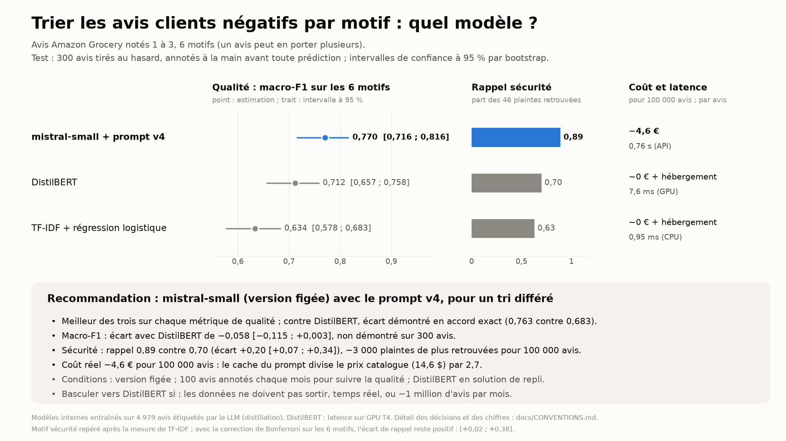

# Review Intelligence

**Français** · [English](README.md)

Trier automatiquement les avis clients négatifs par motif d'insatisfaction, pour les envoyer à la bonne équipe.
Trois approches comparées sur la qualité, le coût et la latence : TF-IDF + régression logistique, DistilBERT fine-tuné,
LLM Mistral par API. Puis une recommandation chiffrée. Partie 2 : un RAG qui rédige une réponse à chaque avis,
fondée sur une politique client, évaluée avec un LLM-juge calibré ([plus bas](#partie-2--rédiger-les-réponses-avec-un-rag)).

Données : Amazon Reviews 2023 (McAuley Lab), catégorie Grocery_and_Gourmet_Food, avis en anglais notés 1 à 3
(Y. Hou, J. Li, Z. He, A. Yan, X. Chen et J. McAuley (2024), « Bridging Language and Items for Retrieval and
Recommendation », [arXiv:2403.03952](https://arxiv.org/abs/2403.03952)). Le dépôt ne contient aucun texte d'avis :
seulement les identifiants et les motifs des 300 avis annotés.



## En bref

- **Recommandation : `mistral-small-2603` avec le prompt v4**, pour un tri différé des avis.
- **Qualité** sur 300 avis annotés à la main : macro-F1 0,770 [0,716 ; 0,816], accord exact 0,763 [0,717 ; 0,810].
  Pour repère, l'annotateur ne s'accorde avec lui-même qu'à 0,70 [0,58 ; 0,82] (2e passe contre 1re, sur 50 de ces
  avis) : la tâche est ambiguë. Ce repère, mesuré sur une autre cible et moins d'avis, ne se compare pas directement
  à 0,763.
- **Coût réel : ~4,6 € pour 100 000 avis** (facture du fournisseur ; le cache du prompt divise le prix catalogue par 2,7).
  Latence : 0,76 s par avis.
- **DistilBERT**, entraîné sur 4 979 avis étiquetés par le LLM : macro-F1 0,712, écart avec le LLM de −0,058
  [−0,115 ; +0,003], non démontré sur la métrique principale. Deux écarts sont démontrés (intervalles appariés
  excluant 0) : l'accord exact (−0,080 [−0,133 ; −0,030]) et le rappel des plaintes de sécurité alimentaire (0,70 contre
  0,89 ; −0,196 [−0,340 ; −0,069]), soit ~3 000 plaintes de sécurité manquées en plus pour 100 000 avis (entre ~1 000 et
  ~5 000).
- **Conditions** : version du modèle figée ; 100 avis annotés chaque mois pour suivre la qualité ; DistilBERT gardé en
  solution de repli (panne de l'API, client dont les données ne doivent pas sortir).
- **Ce qui ferait changer la recommandation** : une contrainte de confidentialité, un besoin de temps réel, ou un volume
  de l'ordre du million d'avis par mois (seuil à chiffrer avec le coût d'hébergement d'un modèle interne).

## Le problème

Un avis peut porter plusieurs motifs (multi-étiquette). Liste v2, validée sur 200 avis d'exploration :

| Motif | Définition | Équipe concernée (exemple) |
| --- | --- | --- |
| `reception` | transport ou colis : retard, perte, produit cassé, fondu, emballage abîmé | logistique |
| `gout_texture` | goût, texture ou odeur d'un produit arrivé intact et non périmé | qualité produit |
| `fraicheur_securite` | périmé, rassis, moisi, insectes, corps étranger, effet sur la santé | sécurité alimentaire |
| `non_conforme` | ne correspond pas à la description : mauvais produit, format, ingrédient non annoncé | catalogue |
| `prix` | trop cher, mauvais rapport quantité / prix, hausse de prix | prix |
| `autre` | aucune plainte rattachable aux motifs ci-dessus ; jamais combiné | service client |

Définitions et frontières complètes : [`docs/CONVENTIONS.md`](docs/CONVENTIONS.md) et le guide d'annotation
[`docs/guide_annotation.md`](docs/guide_annotation.md).

## Résultats

Jeu de test : 300 avis tirés au hasard, annotés à la main avant toute prédiction, jamais vus par un prompt ni par un
entraînement. Intervalles de confiance à 95 % par bootstrap (2 000 tirages d'avis).

| Modèle | macro-F1 | micro-F1 | Accord exact | Rappel sécurité | Coût pour 100 000 avis | Latence par avis |
| --- | --- | --- | --- | --- | --- | --- |
| mistral-small + prompt v4 | **0,770** [0,716 ; 0,816] | 0,843 | **0,763** | **0,89** | ~4,6 € (facture ; 14,6 $ sans cache) | 0,76 s (API) |
| DistilBERT | 0,712 [0,657 ; 0,758] | 0,788 | 0,683 | 0,70 | ~0 € + hébergement | 7,6 ms (GPU T4) |
| TF-IDF + régression logistique | 0,634 [0,578 ; 0,683] | 0,739 | 0,607 | 0,63 | ~0 € + hébergement | 0,95 ms (CPU) |
| Repère : annotateur, 2e passe contre 1re (50 des 300 avis) | – | – | 0,70 [0,58 ; 0,82] | – | – | 18 s |

Le repère ne se compare pas directement aux modèles : il oppose la 2e passe de l'annotateur à sa 1re, sur 50 avis,
alors que les modèles sont mesurés contre la référence arbitrée, sur 300 avis ; son intervalle contient d'ailleurs
0,763. Il indique seulement que la tâche est ambiguë.

Écarts appariés (bootstrap apparié sur les mêmes avis) :

| Comparaison | macro-F1 | Accord exact | Rappel sécurité |
| --- | --- | --- | --- |
| DistilBERT − LLM (comparaison principale) | −0,058 [−0,115 ; +0,003] | −0,080 [−0,133 ; −0,030] | −0,196 [−0,340 ; −0,069] |
| TF-IDF − LLM | −0,137 [−0,200 ; −0,072] | −0,157 [−0,213 ; −0,100] | −0,261 [−0,395 ; −0,135] |

Le rappel sécurité a été retenu après la mesure de TF-IDF, qui montrait sur ce motif l'écart le plus grand : c'est un
choix fait après coup parmi 6 motifs. Avec la correction de Bonferroni (intervalles à 1 − 0,05/6), les écarts restent
négatifs : [−0,383 ; −0,022] pour DistilBERT, [−0,452 ; −0,103] pour TF-IDF. Au seuil utilisé (0,5), le LLM est aussi
plus précis sur ce motif (0,91 contre 0,78) ; baisser le seuil de DistilBERT remonterait son rappel au prix de sa
précision (non essayé).

F1 par motif (support entre parenthèses) :

| Motif | LLM | DistilBERT | TF-IDF |
| --- | --- | --- | --- |
| reception (42) | 0,886 | 0,810 | 0,786 |
| gout_texture (171) | 0,909 | 0,877 | 0,874 |
| fraicheur_securite (46) | 0,901 | 0,736 | 0,652 |
| non_conforme (24) | 0,560 | 0,528 | 0,440 |
| prix (39) | 0,800 | 0,771 | 0,675 |
| autre (32) | 0,566 | 0,552 | 0,375 |

**Lecture.** Le LLM est devant sur tous les motifs. DistilBERT comble une bonne partie de l'écart de TF-IDF, surtout
sur `autre` et `prix`, mais pas sur la sécurité : il manque encore 14 plaintes de fraîcheur sur 46, contre 5 pour le
LLM ; le LLM en retrouve 10 que DistilBERT manque, l'inverse n'arrive qu'une fois. Les deux motifs difficiles pour tous
les modèles (`non_conforme`, `autre`) sont ceux dont la frontière a dû être tranchée par une règle du guide
(« annoncé par défaut », « plainte vague »).

## Démarche

1. **Liste de motifs** vérifiée sur 200 avis d'exploration avec le LLM : une première liste a été rejetée (un motif à
   77 %, un autre à 0 %), la liste v2 retenue.
2. **Référence humaine** : guide d'annotation gelé avant le premier avis de test ; 300 avis annotés à l'aveugle (sans
   voir les prédictions) ; 50 ré-annotés pour mesurer la cohérence (accord exact 0,70) ; désaccords arbitrés. Les
   annotations sont publiées : [`data/annotations_test.jsonl`](data/annotations_test.jsonl).
3. **LLM** : prompt v4 (guide condensé et 6 exemples tirés de l'exploration), sortie structurée (justification, motif
   en clair, puis étiquettes), température 0, modèle figé. 5 000 avis d'entraînement étiquetés pour 0,73 $ au prix
   catalogue. Critères d'acceptation fixés avant les essais ; écarts documentés.
4. **Modèles entraînés sur les étiquettes du LLM** (distillation) : 1 000 avis de validation tirés du train ; réglages
   choisis sur la validation (20 configurations pour TF-IDF, 9 entraînements de DistilBERT sur 3 graines) ;
   ré-entraînement sur les 4 979 avis valides ; une seule mesure sur le test par modèle.

**Principes tenus tout au long** : test gelé ; métrique principale (macro-F1) et comparaison principale fixées avant
les résultats ; chaque décision datée et consignée avant la mesure dans [`docs/CONVENTIONS.md`](docs/CONVENTIONS.md) ;
intervalles de confiance partout ; un écart n'est déclaré que si son intervalle apparié exclut 0.

## Ce que la facture a appris

Au prix catalogue, l'étiquetage revenait à 14,6 $ pour 100 000 avis. La facture réelle est ~2,7 fois plus basse : le
prompt système, identique d'un appel à l'autre, a été servi depuis le cache du fournisseur pour 86,7 % des tokens
d'entrée, facturés 10 % du prix. La sortie (~46 tokens par avis) représente désormais la moitié du coût. Leviers non
essayés : traitement par lots (annoncé à −50 %), sortie plus courte.

## Limites

- Référence construite par **un seul annotateur** ; sa cohérence avec lui-même est mesurée (0,70 sur 50 avis), pas la
  validité de ses définitions pour une autre personne.
- **300 avis de test** : les intervalles font ± 0,05 ; un écart de 0,06 entre le LLM et DistilBERT reste non tranché.
- Rappel sécurité retenu après coup (correction de Bonferroni appliquée ci-dessus) ; seuil de DistilBERT non optimisé
  pour ce motif.
- Prompt v4 retenu malgré 2 critères d'acceptation ratés sur 3 (décision documentée).
- Les modèles internes apprennent les **conventions et les erreurs du LLM** qui les a étiquetés.
- Latence de DistilBERT mesurée sur GPU ; coût d'hébergement des modèles internes non chiffré.

## Partie 2 : rédiger les réponses avec un RAG

Pour un avis négatif, rédiger un brouillon de réponse pour le service client, fondé sur la politique client de la
boutique, avec l'action à mener (remboursement, remplacement, geste commercial, escalade sécurité, escalade, aucune).
Le brouillon est fait pour être relu par une personne avant l'envoi.

**Corpus** : politique client d'une épicerie en ligne fictive, 46 passages de 105 à 157 mots avec des règles chiffrées
(30 jours pour réclamer, remboursement sous 5 jours ouvrés, équipe sécurité sous 24 h...), premier jet généré par un
LLM puis relu à la main : [`corpus/politique_client.jsonl`](corpus/politique_client.jsonl). La politique est fictive
parce qu'Amazon Reviews 2023 ne contient ni politique ni réponse des vendeurs.

**Chaîne**, écrite à la main sans framework ([`src/rag.py`](src/rag.py)) :

1. **Recherche** : l'avis est transformé en vecteur par `mistral-embed` ; recherche exacte par cosinus sur les 46
   passages (numpy, vecteurs normalisés) ; les 8 passages les plus proches entrent dans le prompt.
2. **Génération** : `mistral-small-2603`, prompt `rag_v5`, température 0, sortie structurée. Le modèle écrit d'abord
   la phrase la plus négative de l'avis, entre guillemets, et le cas (sécurité, sans plainte, plainte), puis la
   réponse, ses citations (`[P12]`) et l'action. Choisir le cas avant de rédiger a réglé l'erreur de sécurité vue avec
   les premiers prompts (des éclats de noyaux traités comme un problème de goût).
3. **Contrôles en code**, sans appel supplémentaire : passages cités existants, fournis et présents dans le texte ;
   cas cohérent avec l'action ; condition supposée remplie (« since this was your first purchase ») ; mots de sécurité
   dans l'avis sans escalade sécurité.
4. **Relance corrective** (version `rag_v5d`) : si le cas contredit la phrase citée, ou si un mot de sécurité ou une
   condition supposée est détecté, une seule relance avec la première réponse et un message qui nomme le problème. Ce
   qui reste est signalé au relecteur, pas corrigé.

**Jeux d'évaluation** : tirés une fois de la réserve, sans aucun avis commun avec le test de 300 avis : `rag_dev`
(50 avis, pour la mise au point) et `rag_eval` (150 avis, gelé ; les 50 premiers sont utilisés).

| Étape | Ce qui est mesuré | Résultat |
| --- | --- | --- |
| Recherche | rappel@8 (au moins un passage pertinent dans les 8 premiers), 26 avis de `rag_dev` aux passages pertinents annotés à la main | 0,885 (rappel@5 : 0,769 [0,615 ; 0,923]) |
| Notes humaines | 20 réponses du prompt v4, 3 critères oui / non : action conforme, fondée, ton | 2 acceptables sur 20 |
| LLM-juge | `mistral-large-2512` contre les 20 notes humaines, critère par critère | validé sur l'action conforme seulement (κ = 0,79) |
| Générateur | action conforme selon le juge, v4 → v5d, 50 avis de `rag_dev`, apparié | 0,40 → **0,74**, +0,34 [+0,18 ; +0,50] |
| RAG contre toute la politique | action conforme, 50 avis de `rag_eval`, apparié | 0,68 contre 0,78, écart non démontré |

### Ce que l'évaluation a appris

**Une recherche sans filtre.** Limiter la recherche aux passages des motifs prédits par le classifieur de la partie 1
excluait le bon passage chaque fois que le classifieur se trompait, dont un passage de sécurité. Retenu : k = 8,
sans filtre (8 passages au lieu de 5 coûtent ~0,00007 $ de plus par réponse).

**On ne fait confiance au juge que là où il a été vérifié.** Les 20 notes humaines sont venues d'abord. La règle
d'acceptation a été fixée avant de lancer le moindre juge : pour chaque critère, rappel des fautes ≥ 0,80, précision
≥ 0,67, κ ≥ 0,40 (sur le ton, 14 réponses sur 20 étaient fautives : un juge qui dit « fautive » à tout gardait une
précision de 0,70 ; le κ l'écarte). Trois juges essayés (Large 3 avec deux versions du prompt, puis la préversion de
Large 4) : aucun ne passe les trois critères. Sur le ton, les juges notent la politesse plutôt que le fait de
répondre au problème précis. Retenu : Large 3 avec le prompt de juge v2, **pour l'action conforme seulement** ;
fondée et ton ne sont couverts que par les 20 notes humaines et les contrôles en code.

**Une règle que le modèle n'applique pas passe dans le code.** Avec le prompt v4, 8 des 10 réponses classées « sans
plainte » répondaient à de vraies plaintes (goût, odeur, date dépassée, taille). Le prompt v5, avec une définition
plus stricte, n'a rien changé (0,38 contre 0,40) : dans 22 cas sur 26, le modèle citait une phrase négative et
choisissait quand même « sans plainte ». Une relance déclenchée par le code a réglé le problème : 0,70 (v5c, relance
sur ce cas seulement), puis 0,74 (v5d, aussi sur les mots de sécurité et les conditions supposées) ; 20 avis gagnés
contre 3. La règle d'adoption a été corrigée après la mesure, à découvert (escalades de sécurité comptées dans les
deux sens), et la correction est consignée dans [`docs/CONVENTIONS.md`](docs/CONVENTIONS.md). Erreur connue qui
reste : un avis qui mentionne des éclats de noyaux, escaladé par v4, reçoit un avoir avec v5d (réponse signalée au
relecteur).

**RAG ou toute la politique dans le prompt ?** Même générateur (`rag_v5d`), mêmes 50 avis de `rag_eval` :

| | RAG (8 passages) | Toute la politique (46 passages) |
| --- | --- | --- |
| Action conforme (juge) | 0,68 | 0,78 |
| Écart apparié, toute la politique − RAG | | +0,10 [−0,02 ; +0,22] ; 8 avis gagnés contre 3, test du signe p = 0,23 |
| Réponses signalées par les contrôles en code | 22 % | 8 % |
| Tokens d'entrée / de sortie par réponse | 3 553 / 182 | 10 795 / 183 |
| Latence médiane | 1,55 s | 1,89 s |

À 46 passages, mettre toute la politique dans le prompt fait au moins aussi bien, plus simplement (pas d'index, pas
de passage raté, pas de citation hors des passages fournis), et avec le cache du prompt le coût par réponse est voisin
(~0,0005 $, estimé, non vérifié sur la facture). Le service garde pourtant le RAG, avec le mode « toute la politique »
en option : l'écart n'est pas démontré, le RAG envoie 3 fois moins de tokens (~2,7 fois moins cher sans cache), répond
plus vite, et son coût ne grandit pas avec le corpus. Le RAG devient nécessaire quand le corpus ne tient plus dans le
contexte (~1 500 passages de cette taille) ou quand les droits d'accès diffèrent d'un document à l'autre.

### Limites de la partie 2

- Politique fictive, courte et cohérente ; une vraie politique est plus longue et se contredit.
- **Un seul noteur, 20 réponses** ; le prompt du juge a été réglé sur ces mêmes 20 réponses (biais du gagnant), et sa
  validité sur l'action est supposée se transférer des réponses v4 aux réponses v5d.
- **50 avis par comparaison** : les intervalles font environ ± 0,15.
- Recherche mesurée sur 26 avis de `rag_dev` seulement, pas remesurée sur `rag_eval`.
- Fondée et ton de la version finale ne sont pas mesurés par un juge validé ; 22 % des réponses du RAG sont signalées
  par les contrôles en code. Les réponses sont des brouillons à faire relire par une personne.

Suite : une API (FastAPI), une image Docker et une démo Streamlit.

## Reproduire

Installation (Windows) :

```
python -m venv .venv
.venv\Scripts\activate
pip install -r requirements.txt
copy .env.example .env          (puis y mettre MISTRAL_API_KEY)
python -m pytest -q
```

Étapes :

```
python -m src.data --n-read 500000                          # réservoir et découpage (graine 42) -> data/pool.parquet
python -m src.label_llm --part explo --prompt v4            # étiquetage LLM (aussi --part train, --part test)
python -m src.report data/labels_explo_v4.jsonl             # parts des motifs, invalides, coût, latence
python -m src.annotate                                      # annotation manuelle des 300 avis de test
python -m src.metrics accord                                # cohérence de l'annotateur (passe 1 contre passe 2)
python -m src.metrics eval data/labels_test_v4.jsonl        # un modèle contre la référence
python -m src.tfidf_lr grid                                 # TF-IDF : grille sur la validation
python -m src.tfidf_lr final                                # TF-IDF : mesure unique sur le test
python -m src.distilbert paquet                             # DistilBERT : paquet pour Colab
                                                            # puis notebooks/distilbert_colab.ipynb (GPU T4)
python -m src.distilbert compare --out-dir DOSSIER          # TF-IDF contre DistilBERT sur la validation
python -m src.metrics eval data/labels_test_v4.jsonl --contre data/preds_test_distilbert.jsonl
python livrable/slide.py                                    # slides de synthèse (anglais et français, PNG et PDF)
```

Partie 2 (RAG) :

```
python -m src.rag index                                     # vecteurs de la politique -> data/rag/index.npy
python -m src.rag jeux                                      # tirage de rag_dev (50) et rag_eval (150) dans la réserve
python -m src.rag annoter --part rag_dev                    # passages pertinents, annotés à la main
python -m src.rag eval-recherche --part rag_dev             # rappel@k et MRR
python -m src.rag repondre --part rag_dev --prompt rag_v5 --correction-etendue   # réponses (rag_v5d)
python -m src.juge page --part rag_dev                      # page HTML pour noter les réponses à la main
python -m src.juge juger --part rag_dev --prompt rag_v4     # LLM-juge sur les réponses
python -m src.juge calibrer --part rag_dev                  # juge contre les notes humaines, critère par critère
python -m src.juge bilan --part rag_dev --prompt rag_v5d --contre rag_v4   # comparaison appariée de deux versions
python -m src.rag repondre --part rag_eval --mode plein --prompt rag_v5 --correction-etendue --limit 50
python -m src.juge comparer --prompt rag_v5d                # RAG contre toute la politique sur rag_eval
```

## Organisation

| Chemin | Contenu |
| --- | --- |
| `src/data.py` | lecture en flux, nettoyage, réservoir de 20 000 avis, découpage explo / test / train |
| `src/label_llm.py` | étiquetage par l'API Mistral : sortie structurée, règles, reprises, reprise après coupure |
| `src/report.py`, `src/compare_prompts.py` | analyse des étiquettes, comparaison de prompts |
| `src/annotate.py` | outil d'annotation en ligne de commande (passes, doutes, arbitrage) |
| `src/metrics.py` | kappa, F1 par motif, micro / macro, bootstrap, bootstrap apparié |
| `src/tfidf_lr.py` | TF-IDF + régression logistique : grille, mesure finale, explication des prédictions |
| `src/distilbert.py` | DistilBERT : grille avec reprise, mesure finale, comparaison avec TF-IDF |
| `notebooks/distilbert_colab.ipynb` | lancement de DistilBERT sur Colab |
| `src/rag.py` | RAG : index, recherche, rédaction, contrôles en code, relance corrective, rappel@k |
| `src/juge.py`, `src/gabarit_notation.html` | LLM-juge : page de notation, jugement, calibration, comparaisons appariées |
| `corpus/politique_client.jsonl` | politique client fictive (46 passages) |
| `prompts/` | prompts versionnés : classement v1 à v4, réponses `rag_v1` à `rag_v5`, juge `juge_v1` et `juge_v2` |
| `tests/` | 114 tests (`python -m pytest -q`) |
| `docs/CONVENTIONS.md` | toutes les décisions et tous les chiffres, datés |
| `docs/guide_annotation.md` | guide d'annotation (v1, gelé) |
| `livrable/` | slides de synthèse : `slide.py` produit `synthese.png` / `.pdf` (anglais) et `synthese_fr.png` / `.pdf` (français) |

Code sous licence MIT (voir [`LICENSE`](LICENSE)).
