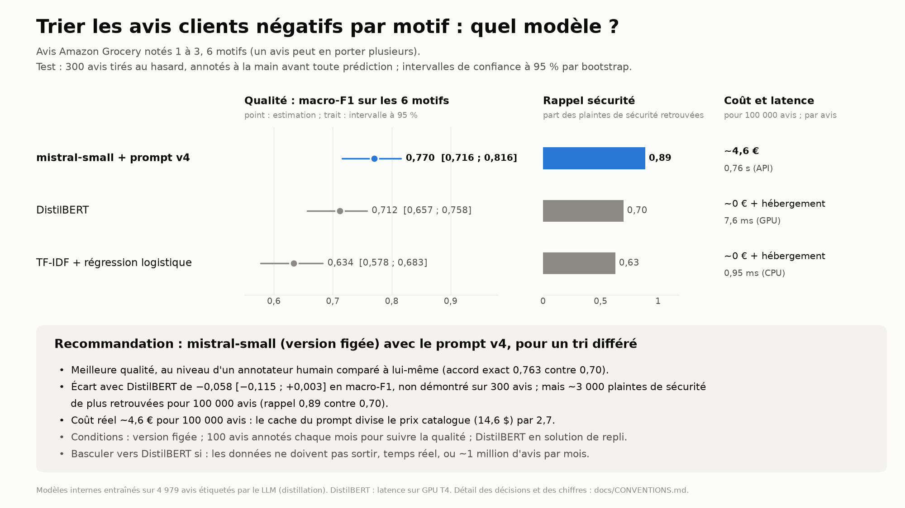

# Review Intelligence

Trier automatiquement les avis clients négatifs par motif d'insatisfaction, pour les envoyer à la bonne équipe.
Trois approches comparées sur la qualité, le coût et la latence : TF-IDF + régression logistique, DistilBERT fine-tuné,
LLM Mistral par API. Puis une recommandation chiffrée.

Données : Amazon Reviews 2023 (McAuley Lab), catégorie Grocery_and_Gourmet_Food, avis en anglais notés 1 à 3
(Y. Hou, J. Li, Z. He, A. Yan, X. Chen et J. McAuley (2024), « Bridging Language and Items for Retrieval and
Recommendation », [arXiv:2403.03952](https://arxiv.org/abs/2403.03952)). Le dépôt ne contient aucun texte d'avis :
seulement les identifiants et les motifs des 300 avis annotés.



## En bref

- **Recommandation : `mistral-small-2603` avec le prompt v4**, pour un tri différé des avis.
- **Qualité** sur 300 avis annotés à la main : macro-F1 0,770 [0,716 ; 0,816], accord exact 0,763, au niveau de la
  cohérence de l'annotateur avec lui-même (0,70 sur 50 avis ré-annotés).
- **Coût réel : ~4,6 € pour 100 000 avis** (facture du fournisseur ; le cache du prompt divise le prix catalogue par 2,7).
  Latence : 0,76 s par avis.
- **DistilBERT**, entraîné sur 4 979 avis étiquetés par le LLM : macro-F1 0,712, écart avec le LLM de −0,058
  [−0,115 ; +0,003], non démontré sur la métrique principale ; mais le LLM retrouve nettement plus de plaintes de
  sécurité alimentaire (rappel 0,89 contre 0,70, soit ~3 000 plaintes de plus pour 100 000 avis).
- **Conditions** : version du modèle figée ; 100 avis annotés chaque mois pour suivre la qualité ; DistilBERT gardé en
  solution de repli (panne de l'API, client dont les données ne doivent pas sortir).
- **Ce qui ferait changer la recommandation** : une contrainte de confidentialité, un besoin de temps réel, ou un volume
  de l'ordre du million d'avis par mois (seuil à chiffrer avec le coût d'hébergement d'un modèle interne).

## Le problème

Un avis peut porter plusieurs motifs (multi-étiquette). Liste v2, validée sur 200 avis d'exploration :

| Motif | Définition | Équipe concernée (exemple) |
| --- | --- | --- |
| `reception` | transport ou colis : retard, perte, produit cassé, fondu, emballage abîmé | logistique |
| `gout_texture` | goût, texture ou odeur d'un produit arrivé intact et non périmé | qualité produit |
| `fraicheur_securite` | périmé, rassis, moisi, insectes, corps étranger, effet sur la santé | sécurité alimentaire |
| `non_conforme` | ne correspond pas à la description : mauvais produit, format, ingrédient non annoncé | catalogue |
| `prix` | trop cher, mauvais rapport quantité / prix, hausse de prix | prix |
| `autre` | aucune plainte rattachable aux motifs ci-dessus ; jamais combiné | service client |

Définitions et frontières complètes : [`docs/CONVENTIONS.md`](docs/CONVENTIONS.md) et le guide d'annotation
[`docs/guide_annotation.md`](docs/guide_annotation.md).

## Résultats

Jeu de test : 300 avis tirés au hasard, annotés à la main avant toute prédiction, jamais vus par un prompt ni par un
entraînement. Intervalles de confiance à 95 % par bootstrap (2 000 tirages d'avis).

| Modèle | macro-F1 | micro-F1 | Accord exact | Rappel sécurité | Coût pour 100 000 avis | Latence par avis |
| --- | --- | --- | --- | --- | --- | --- |
| mistral-small + prompt v4 | **0,770** [0,716 ; 0,816] | 0,843 | **0,763** | **0,89** | ~4,6 € (facture ; 14,6 $ sans cache) | 0,76 s (API) |
| DistilBERT | 0,712 [0,657 ; 0,758] | 0,788 | 0,683 | 0,70 | ~0 € + hébergement | 7,6 ms (GPU T4) |
| TF-IDF + régression logistique | 0,634 [0,578 ; 0,683] | 0,739 | 0,607 | 0,63 | ~0 € + hébergement | 0,95 ms (CPU) |
| Repère humain (annotateur contre lui-même, 50 avis) | – | – | 0,70 [0,58 ; 0,82] | – | – | 18 s |

Écarts appariés (bootstrap apparié sur les mêmes avis) :

| Comparaison | macro-F1 | Accord exact |
| --- | --- | --- |
| DistilBERT − LLM (comparaison principale) | −0,058 [−0,115 ; +0,003] | −0,080 [−0,133 ; −0,030] |
| TF-IDF − LLM | −0,137 [−0,200 ; −0,072] | −0,157 [−0,213 ; −0,100] |

F1 par motif (support entre parenthèses) :

| Motif | LLM | DistilBERT | TF-IDF |
| --- | --- | --- | --- |
| reception (42) | 0,886 | 0,810 | 0,786 |
| gout_texture (171) | 0,909 | 0,877 | 0,874 |
| fraicheur_securite (46) | 0,901 | 0,736 | 0,652 |
| non_conforme (24) | 0,560 | 0,528 | 0,440 |
| prix (39) | 0,800 | 0,771 | 0,675 |
| autre (32) | 0,566 | 0,552 | 0,375 |

**Lecture.** Le LLM est devant sur tous les motifs. DistilBERT comble une bonne partie de l'écart de TF-IDF, surtout
sur `autre` et `prix`, mais pas sur la sécurité : il manque encore 14 plaintes de fraîcheur sur 46, contre 5 pour le
LLM. Les deux motifs difficiles pour tous les modèles (`non_conforme`, `autre`) sont ceux dont la frontière a dû être
tranchée par une règle du guide (« annoncé par défaut », « plainte vague »).

## Démarche

1. **Liste de motifs** vérifiée sur 200 avis d'exploration avec le LLM : une première liste a été rejetée (un motif à
   77 %, un autre à 0 %), la liste v2 retenue.
2. **Référence humaine** : guide d'annotation gelé avant le premier avis de test ; 300 avis annotés à l'aveugle (sans
   voir les prédictions) ; 50 ré-annotés pour mesurer la cohérence (accord exact 0,70) ; désaccords arbitrés. Les
   annotations sont publiées : [`data/annotations_test.jsonl`](data/annotations_test.jsonl).
3. **LLM** : prompt v4 (guide condensé et 6 exemples tirés de l'exploration), sortie structurée (justification, motif
   en clair, puis étiquettes), température 0, modèle figé. 5 000 avis d'entraînement étiquetés pour 0,73 $ au prix
   catalogue. Critères d'acceptation fixés avant les essais ; écarts documentés.
4. **Modèles entraînés sur les étiquettes du LLM** (distillation) : 1 000 avis de validation tirés du train ; réglages
   choisis sur la validation (20 configurations pour TF-IDF, 9 entraînements de DistilBERT sur 3 graines) ;
   ré-entraînement sur les 4 979 avis valides ; une seule mesure sur le test par modèle.

**Principes tenus tout au long** : test gelé ; métrique principale (macro-F1) et comparaison principale fixées avant
les résultats ; chaque décision datée et consignée avant la mesure dans [`docs/CONVENTIONS.md`](docs/CONVENTIONS.md) ;
intervalles de confiance partout ; un écart n'est déclaré que si son intervalle apparié exclut 0.

## Ce que la facture a appris

Au prix catalogue, l'étiquetage revenait à 14,6 $ pour 100 000 avis. La facture réelle est ~2,7 fois plus basse : le
prompt système, identique d'un appel à l'autre, a été servi depuis le cache du fournisseur pour 86,7 % des tokens
d'entrée, facturés 10 % du prix. La sortie (~46 tokens par avis) représente désormais la moitié du coût. Leviers non
essayés : traitement par lots (annoncé à −50 %), sortie plus courte.

## Limites

- Référence construite par **un seul annotateur** ; sa cohérence est mesurée (0,70), pas la validité de ses définitions
  pour une autre personne.
- **300 avis de test** : les intervalles font ± 0,05 ; un écart de 0,06 entre le LLM et DistilBERT reste non tranché.
- Prompt v4 retenu malgré 2 critères d'acceptation ratés sur 3 (décision documentée).
- Les modèles internes apprennent les **conventions et les erreurs du LLM** qui les a étiquetés.
- Latence de DistilBERT mesurée sur GPU ; coût d'hébergement des modèles internes non chiffré.

## Reproduire

Installation (Windows) :

```
python -m venv .venv
.venv\Scripts\activate
pip install -r requirements.txt
copy .env.example .env          (puis y mettre MISTRAL_API_KEY)
python -m pytest -q
```

Étapes :

```
python -m src.data --n-read 500000                          # réservoir et découpage (graine 42) -> data/pool.parquet
python -m src.label_llm --part explo --prompt v4            # étiquetage LLM (aussi --part train, --part test)
python -m src.report data/labels_explo_v4.jsonl             # parts des motifs, invalides, coût, latence
python -m src.annotate                                      # annotation manuelle des 300 avis de test
python -m src.metrics accord                                # cohérence de l'annotateur (passe 1 contre passe 2)
python -m src.metrics eval data/labels_test_v4.jsonl        # un modèle contre la référence
python -m src.tfidf_lr grid                                 # TF-IDF : grille sur la validation
python -m src.tfidf_lr final                                # TF-IDF : mesure unique sur le test
python -m src.distilbert paquet                             # DistilBERT : paquet pour Colab
                                                            # puis notebooks/distilbert_colab.ipynb (GPU T4)
python -m src.distilbert compare --out-dir DOSSIER          # TF-IDF contre DistilBERT sur la validation
python -m src.metrics eval data/labels_test_v4.jsonl --contre data/preds_test_distilbert.jsonl
python livrable/slide.py                                    # slide de synthèse (PNG et PDF)
```

## Organisation

| Chemin | Contenu |
| --- | --- |
| `src/data.py` | lecture en flux, nettoyage, réservoir de 20 000 avis, découpage explo / test / train |
| `src/label_llm.py` | étiquetage par l'API Mistral : sortie structurée, règles, reprises, reprise après coupure |
| `src/report.py`, `src/compare_prompts.py` | analyse des étiquettes, comparaison de prompts |
| `src/annotate.py` | outil d'annotation en ligne de commande (passes, doutes, arbitrage) |
| `src/metrics.py` | kappa, F1 par motif, micro / macro, bootstrap, bootstrap apparié |
| `src/tfidf_lr.py` | TF-IDF + régression logistique : grille, mesure finale, explication des prédictions |
| `src/distilbert.py` | DistilBERT : grille avec reprise, mesure finale, comparaison avec TF-IDF |
| `notebooks/distilbert_colab.ipynb` | lancement de DistilBERT sur Colab |
| `prompts/` | prompts versionnés v1 à v4 |
| `tests/` | 67 tests (`python -m pytest -q`) |
| `docs/CONVENTIONS.md` | toutes les décisions et tous les chiffres, datés |
| `docs/guide_annotation.md` | guide d'annotation (v1, gelé) |
| `livrable/` | slide de synthèse (`slide.py` produit `synthese.png` et `synthese.pdf`) |

Code sous licence MIT (voir [`LICENSE`](LICENSE)).
